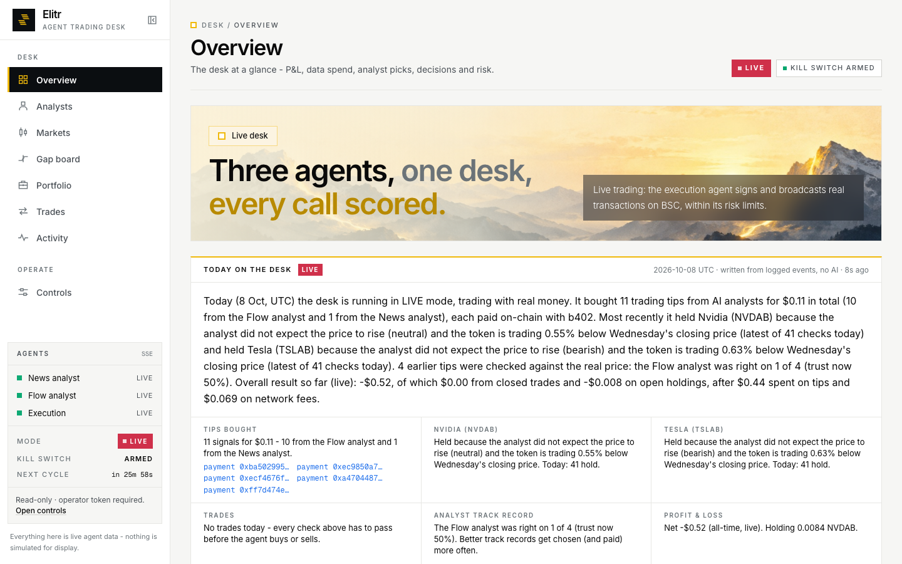
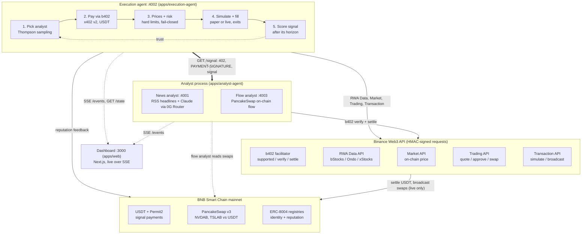
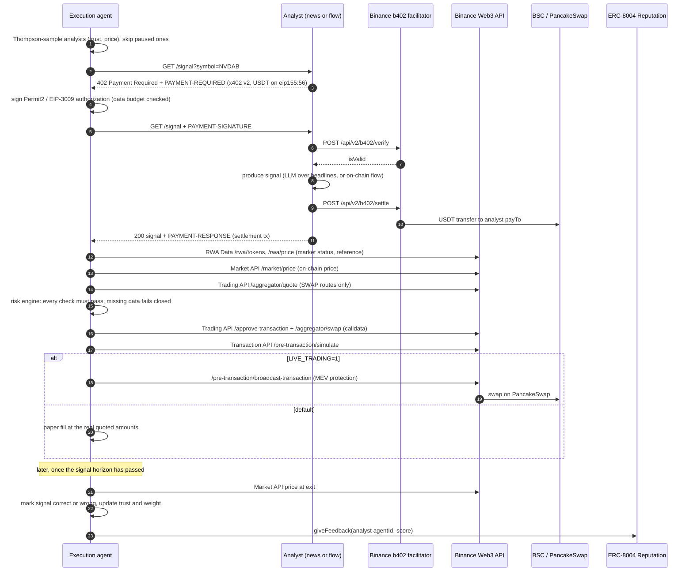

# Elitr

[](https://github.com/mrnetwork0001/Elitr/actions/workflows/ci.yml)


**An agent-to-agent market for tokenized-stock signals on BNB Chain.** Analyst agents sell trading signals for bStocks (NVDAB, TSLAB) behind an HTTP 402 paywall settled with **Binance b402**. An execution agent decides which analyst to pay with Thompson sampling, pays a cent in USDT per signal, checks the signal against Binance RWA Data, Market and Trading API prices and a set of hard risk limits, **dry-runs every transaction with the Binance Transaction API**, and then fills on PancakeSwap: as a paper fill, or live once you turn that on. Every signal is scored against the price after its horizon, so analysts earn a track record. That track record decides who gets paid next time, and it is posted on-chain as ERC-8004 reputation feedback. A Next.js dashboard streams the whole loop live over SSE.

> Built for **BNB Hack: Tokenized Stocks**. BSC mainnet only. Simulate-only by default (`LIVE_TRADING=0`).

| Landing | Dashboard |
| --- | --- |
|  |  |

---

## Contents

[Architecture](#architecture) · [One cycle](#one-cycle-sequence) · [Features vs judging criteria](#features-mapped-to-judging-criteria) · [Risk controls](#risk-controls) · [Binance APIs used](#binance-web3-apis-used) · [Quickstart](#quickstart) · [Configuration](#configuration) · [Safety](#safety-notes) · [Repo layout](#repo-layout) · [Docs](#more-docs)

## Architecture



Three services, all plain `node:http`, no framework:

| Service | Port | Role |
| --- | --- | --- |
| `apps/analyst-agent` (news) | 4001 | b402 merchant. Pulls NVDA/TSLA headlines (Yahoo Finance + Google News RSS) and scores them 1-100 with Claude through the 0G Compute Router (Anthropic Messages format). Charges per `GET /signal`. |
| `apps/analyst-agent` (flow) | 4003 | Second seller in the same process. Deterministic signal from PancakeSwap on-chain flow. |
| `apps/execution-agent` | 4002 | b402 buyer and trader: chooses an analyst, pays, prices, runs risk checks, simulates, fills, exits, scores signals, posts reputation. |
| `apps/web` | 3000 | Landing page + live dashboard (SSE from all agents, `GET /state` from execution). |

## One cycle (sequence)



## Features mapped to judging criteria

| Criterion (weight) | What Elitr does |
| --- | --- |
| **Technical implementation (30%)** | Hand-written signed client for 5 Binance Web3 API modules (RWA Data, Market, Trading, Transaction, b402) in `packages/binance`. Full b402 merchant (x402 v2 `402` / `PAYMENT-SIGNATURE` / `PAYMENT-RESPONSE`, single-use authorizations, settle only after the signal is produced) and buyer (`@x402/fetch` + `@bnb-chain/b402`, Permit2 approval handling). Every approve and swap is simulated through the Transaction API before broadcast. Risk engine fails closed on missing data, and it has unit tests. State persists atomically. CI runs on Node 22 and 24, and Docker images are provided. |
| **Creativity & originality (25%)** | Agents *buy information from each other*: a market of competing analysts with real micropayments. The buyer learns which seller to trust (Beta-Bernoulli posterior + Thompson sampling, price-aware) and publishes the result as portable ERC-8004 on-chain reputation. Two very different sellers compete: an LLM news reader and a deterministic on-chain flow reader. |
| **Developer Experience Report (25%)** | [`DEVELOPER_EXPERIENCE.md`](DEVELOPER_EXPERIENCE.md) is written by the team. It is backed by [`docs/dx-raw-log.md`](docs/dx-raw-log.md), a timestamped evidence log that the execution agent also appends to automatically when it hits API friction. |
| **Product quality & UX (20%)** | The dashboard shows the payment between agents, the signal and its sources, both reference prices, every risk check with observed vs limit values, the simulation result, fills, positions and P&L, live. There is a kill switch. Defaults are safe: simulate-only, small limits. |

### Status

The repo is under active development until the 11 Oct 2026 deadline. The table shows what is in the code today.

| Feature | Status |
| --- | --- |
| News analyst (:4001) + flow analyst (:4003), both b402 merchants (verify / settle via the Binance facilitator) | Shipped |
| Execution agent: b402 buyer, RWA/Market/Trading/Transaction APIs, risk engine, Transaction API dry-runs | Shipped |
| Thompson-sampling analyst selection, signal scoring, trust / weight / pause (`packages/reputation`) | Shipped |
| NVDAB + TSLAB, exits (take-profit / stop-loss / bearish), paper vs live ledger and P&L | Shipped |
| Control-endpoint auth (`CONTROL_TOKEN`; refuses to bind non-loopback without it) | Shipped |
| Dashboard (landing + live SSE dashboard), CI, Docker images, docker compose | Shipped |
| ERC-8004 identity registration CLI + on-chain reputation feedback (`packages/identity`) | Shipped, opt-in (`ERC8004_POST_FEEDBACK=1`) |
| Agents registered on BSC mainnet ERC-8004, BNB Agent Studio demo | In progress: see [`docs/agent-studio.md`](docs/agent-studio.md) |
| Live (non-paper) trades on mainnet, hosted deployment link | Not yet: default is paper mode |

## Risk controls

Defaults come from [`packages/shared/src/risk.ts`](packages/shared/src/risk.ts). You can override each one with an env var. A check whose input could not be observed this cycle **fails** and shows the reason. It never passes by default.

| Rule | Env var | Default | Meaning |
| --- | --- | --- | --- |
| Kill switch | `KILL_SWITCH` | off | Env flag, or `POST /kill` at runtime (one-way until restart). |
| Max trade | `RISK_MAX_TRADE_USD` | $5 | Notional per trade. |
| Max position | `RISK_MAX_POSITION_USD` | $25 | Per asset, after the trade. |
| Max portfolio | `RISK_MAX_PORTFOLIO_USD` | $50 | All positions combined. |
| Max daily spend | `RISK_MAX_DAILY_SPEND_USD` | $25 | USDT spent on buys per UTC day. |
| Max daily data spend | `RISK_MAX_DAILY_DATA_USD` | $1 | b402 spend on signals per UTC day. |
| Max slippage | `RISK_MAX_SLIPPAGE_BPS` | 100 bps | Route price impact; also pinned as swap slippage. Hard cap 500. |
| Min liquidity | `RISK_MIN_LIQUIDITY_USD` | $50,000 | USDT in the primary PancakeSwap v3 pool. |
| Min confidence | `RISK_MIN_CONFIDENCE` | 65 | Signal score (after the reputation weight), 1-100. |
| Stance | n/a | bullish | Buys need a bullish call. |
| Min gap | `RISK_MIN_GAP_BPS` | 50 bps | On-chain price must sit this far below the TradFi reference. |
| Max signal age | `RISK_MAX_SIGNAL_AGE_SEC` | 300 s | Stale signals are rejected. |
| Take profit | `RISK_TAKE_PROFIT_BPS` | 300 bps | Exit when up this much vs average cost. |
| Stop loss | `RISK_STOP_LOSS_BPS` | 200 bps | Exit when down this much. |
| Exit on bearish | `RISK_EXIT_ON_BEARISH` | on | Sell an open position on a bearish signal. |
| Analyst pause | `RISK_MIN_ANALYST_TRUST` / `RISK_MIN_ANALYST_SAMPLES` | 0.45 / 10 | Stop paying an analyst whose trust falls below 0.45 after 10 scored signals. |
| Simulatable route | n/a | SWAP only | RFQ routes cannot be dry-run, so they are refused. |
| Balances | `EXECUTION_MIN_BNB_GAS` | 0.001 BNB | Enough USDT for the trade and BNB for gas. |

## Binance Web3 APIs used

Base `https://web3.binance.com/build`. Every call is signed (`X-OC-APIKEY`, `X-OC-TIMESTAMP` ISO-8601, `X-OC-NONCE`, `X-OC-RECV-WINDOW`, HMAC `X-OC-SIGN`). See [`packages/binance/src`](packages/binance/src).

| Module | Endpoint | Used by | Purpose |
| --- | --- | --- | --- |
| RWA Data | `GET /api/v1/dex/market/rwa/tokens` | execution | Confirm the asset is a listed bStocks token; market status, next open time. |
| RWA Data | `GET /api/v1/dex/market/rwa/price` | execution | Token price and reference price. |
| RWA Data | `GET /api/v1/dex/market/rwa/underlying-market` | execution | Underlying market data. |
| Market | `POST /api/v1/dex/market/price` | execution | Live on-chain price on BSC. |
| Trading | `GET /api/v1/dex/aggregator/quote` | execution | Cross-DEX quote; only SWAP routes are eligible. |
| Trading | `GET /api/v1/dex/aggregator/approve-transaction` | execution | USDT approval calldata for the route's spender. |
| Trading | `GET /api/v1/dex/aggregator/swap` | execution | Swap calldata with slippage and price-impact protection. |
| Transaction | `POST /api/v1/dex/pre-transaction/simulate` | execution | Dry-run of every approve and swap (and the Permit2 approve). |
| Transaction | `POST /api/v1/dex/pre-transaction/broadcast-transaction` | execution | Broadcast with MEV protection (live mode only). |
| Transaction | `GET /api/v1/dex/post-transaction/transaction-detail-by-txhash` | execution | Post-trade detail. |
| b402 | `POST /api/v2/b402/supported` | analysts | Payment kinds (scheme, network, Permit2 / EIP-3009, signer). |
| b402 | `POST /api/v2/b402/verify` | analysts | Verify the buyer's signed authorization. |
| b402 | `POST /api/v2/b402/settle` | analysts | Settle on-chain after the signal is produced. |

Other data: BSC JSON-RPC via viem (balances, pool liquidity, receipts), Yahoo Finance chart API (independent TradFi reference; the RWA `referencePrice` is derived from the on-chain price), and Yahoo Finance / Google News RSS (headlines).

**Tokenized stocks.** Traded: **NVDAB**, **TSLAB** (bStocks; deep PancakeSwap v3 USDT pools). Tracked but not traded because DEX liquidity is negligible: NVDAon (Ondo), TSLAx (xStocks). Addresses are in [`packages/shared/src/assets.ts`](packages/shared/src/assets.ts) and were verified on-chain.

## Quickstart

Requirements: Node ≥ 22.12 (`.nvmrc` = 24), pnpm 9 (`corepack enable`), a Binance Web3 API key with **B402 Payments** permission, and an LLM key (0G Compute Router or Anthropic).

### Local

```bash
corepack enable
pnpm install
cp .env.example .env        # fill in keys (never commit .env)
pnpm build
pnpm dev                    # analysts :4001 + :4003, execution :4002, dashboard http://localhost:3000
```

Trigger a cycle on demand: `curl -X POST localhost:4002/cycle` (send `Authorization: Bearer $CONTROL_TOKEN` when one is set). Run the checks CI runs: `pnpm build && pnpm typecheck && pnpm test`.

### Docker

```bash
cp .env.example .env        # fill in keys, and set CONTROL_TOKEN (e.g. openssl rand -hex 32)
docker compose up -d --build
open http://localhost:3000
docker compose logs -f execution
docker compose down          # state survives in the elitr-data volume
```

Compose overrides what must differ inside containers: execution binds `0.0.0.0`, which is why `CONTROL_TOKEN` is required, and it reaches the analysts at `http://analyst:4001` / `:4003`. `NEXT_PUBLIC_*` URLs are baked into the dashboard at **build** time. Rebuild `web` after you change them. Port 4002 is published on loopback only. See [`docs/deploy.md`](docs/deploy.md) for hosting (Vercel + Railway/Fly/VPS).

## Configuration

All apps read one `.env` at the repo root. The full annotated list is in [`.env.example`](.env.example).

| Variable | Service | Purpose |
| --- | --- | --- |
| `BINANCE_WEB3_API_KEY`, `BINANCE_WEB3_API_SECRET` | all | Binance Web3 API credentials (analyst key needs B402 Payments permission). |
| `ANALYST_PORT` | analyst | News analyst port (4001). The flow analyst listens on 4003. |
| `ANALYST_PAY_TO` | analyst | Merchant payTo. Must equal the write-once address set in B402 onboarding. |
| `ANALYST_PRICE_WEI` | analyst | Price per signal in smallest units (default 0.01 of an 18-decimal stablecoin). |
| `ANALYST_PAYMENT_ASSET`, `ANALYST_PAYMENT_METHOD` | analyst | USDT + `permit2-exact` (default), or U / USD1 + `eip3009`. |
| `ANALYST_PAYMENT_TOKEN_NAME`, `ANALYST_PAYMENT_TIMEOUT_SEC` | analyst | Kind disambiguation, authorization validity. |
| `ANALYST_PUBLIC_URL` | analyst | Public URL put in the 402 `resource` field. |
| `ANTHROPIC_BASE_URL`, `ANTHROPIC_AUTH_TOKEN` | analyst | 0G Compute Router (Claude over the Anthropic Messages API). |
| `ANTHROPIC_API_KEY` | analyst | Alternative: Anthropic directly. |
| `ANALYST_MODEL`, `SIGNAL_CACHE_SEC`, `ANALYST_HORIZON_SEC` | analyst | Model id, signal cache TTL, horizon a news call is scored over. |
| `FLOW_ANALYST_PORT`, `FLOW_ANALYST_PAY_TO`, `FLOW_ANALYST_PRICE_WEI`, `FLOW_ANALYST_PUBLIC_URL` | analyst | Flow analyst port (4003, `0` disables), its merchant payTo / price / public URL (fall back to the news analyst's). |
| `FLOW_RPC_URL`, `FLOW_LOOKBACK_SEC`, `FLOW_MIN_SWAPS`, `FLOW_LARGE_TRADE_USD`, `FLOW_HORIZON_SEC`, `FLOW_LOGS_CHUNK_BLOCKS` | analyst | On-chain flow window and thresholds. |
| `EXECUTION_PORT`, `EXECUTION_HOST` | execution | Bind address (default `127.0.0.1:4002`). |
| `CONTROL_TOKEN` | execution | Bearer token for `POST /cycle` and `/kill`. Required when the host is not loopback. |
| `ANALYSTS`, `ANALYST_URL` | execution | Analysts to buy from (`id=url,...`), legacy single URL. |
| `EXECUTION_PRIVATE_KEY` | execution | Dedicated hot wallet. Fund with small amounts only. |
| `BSC_RPC_URL` | execution | BSC JSON-RPC. |
| `EXECUTION_TRADE_USD`, `EXECUTION_MIN_BNB_GAS`, `EXECUTION_MEV_PROTECTION` | execution | Trade size, gas floor, MEV-protected broadcast. |
| `B402_TRUSTED_SPENDERS` | execution | Override the curated b402 Permit2 spenders. |
| `LOOP_INTERVAL_SEC` | execution | Seconds between cycles (`0` = on-demand only). |
| `EXECUTION_DATA_DIR` | execution | Override the state directory (default `<repo>/data`). |
| `LIVE_TRADING` | execution | `1` to sign and broadcast. Anything else is simulate-only. |
| `RISK_*`, `KILL_SWITCH` | execution | See [Risk controls](#risk-controls). |
| `ERC8004_CHAIN_ID`, `ERC8004_RPC_URL`, `ERC8004_*_REGISTRY` | identity | Chain and registries (canonical BSC 56 / 97 addresses by default). |
| `ERC8004_AGENT_ID_ANALYST`, `ERC8004_AGENT_ID_ANALYST_FLOW`, `ERC8004_AGENT_ID_EXECUTION` | all | Agent ids after `pnpm --filter @elitr/identity register`. |
| `ANALYST_OWNER_PRIVATE_KEY`, `ANALYST_FLOW_OWNER_PRIVATE_KEY`, `EXECUTION_PUBLIC_URL` | identity | Owner keys for registration (must differ from the trader key: no self-feedback). |
| `ERC8004_POST_FEEDBACK` | execution | `1` = post each scored analyst's accuracy on-chain (costs gas). |
| `NEXT_PUBLIC_ANALYST_URL`, `NEXT_PUBLIC_FLOW_ANALYST_URL`, `NEXT_PUBLIC_EXECUTION_URL` | web | Agent URLs the browser connects to (build time). |
| `DASHBOARD_ORIGIN` | agents | CORS origin allowed to read the agents. |

## Safety notes

- **Simulate-only by default.** Quotes, prices, simulations and b402 payments are real, but no swap is signed or broadcast until `LIVE_TRADING=1`. The Permit2 approval for b402 is also simulated and *not sent* in that mode.
- **Every transaction is dry-run** through the Transaction API first. A failed simulation stops the trade.
- **Use a dedicated hot wallet** (`EXECUTION_PRIVATE_KEY`) with a few dollars of USDT and BNB. Approvals are bounded to the trade amount (swap) or a small budget (Permit2). They are never unlimited.
- **Control endpoints** (`POST /cycle`, `/kill`) bind to loopback by default. Exposing them needs `CONTROL_TOKEN`. `/kill` is one-way until restart.
- **Secrets** live only in `.env` (git-ignored, docker-ignored, never baked into images).
- **Regions.** The Binance Web3 API refuses requests from [restricted regions](https://web3.binance.com/en/dev-docs/web3-api-prohibited-regions) (including the US, Canada, the Netherlands, the UK and Japan). Host the agents somewhere allowed. See [`docs/deploy.md`](docs/deploy.md).
- **Issuer controls.** bStocks and Ondo tokens are upgradeable proxies with a compliance hook, so the issuer can block transfers. Not financial advice. Agents are judged on build quality, not P&L.

## Repo layout

```
apps/
  analyst-agent/     b402 merchant: news analyst :4001 (+ flow analyst :4003), signal + scorer
  execution-agent/   b402 buyer + trader: cycle, pay, prices, risk, trade, ledger, state
  web/               Next.js dashboard (landing + /dashboard)
packages/
  binance/           signed Binance Web3 API client (RWA, Market, Trading, Transaction, b402)
  shared/            assets, risk config, event types, SSE EventHub
  reputation/        signal scoring, Beta trust, Thompson-sampling analyst selection
  identity/          ERC-8004 identity + reputation registry client
docker/              agent.Dockerfile (both agents), web.Dockerfile
docs/                deploy guide, DX evidence log, API reference snapshots
data/                runtime state + event logs (git-ignored, Docker volume)
```

## More docs

- [`ARCHITECTURE.md`](ARCHITECTURE.md): how it works, module by module.
- [`DEVELOPER_EXPERIENCE.md`](DEVELOPER_EXPERIENCE.md): developer experience report (written by the team).
- [`docs/dx-raw-log.md`](docs/dx-raw-log.md): timestamped raw evidence behind the DX report.
- [`docs/agent-studio.md`](docs/agent-studio.md): BNB Agent Studio + ERC-8004 setup.
- [`docs/deploy.md`](docs/deploy.md): Vercel (dashboard) + Railway / Fly.io / VPS (agents).

License: none chosen yet.
